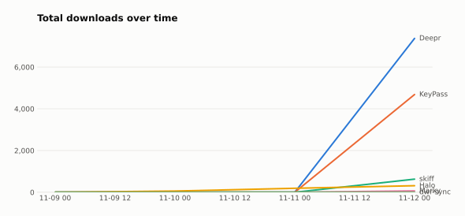
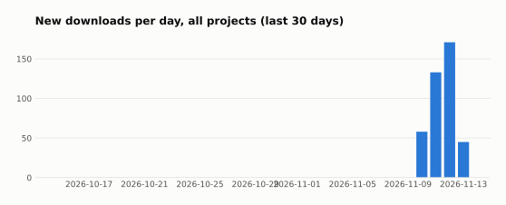
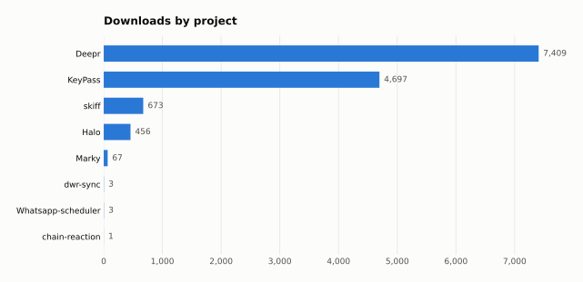
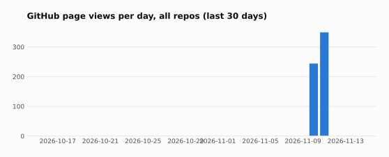

# Project stats

Downloads, stars and traffic for all of my GitHub projects. Updated 2026-11-12 (UTC) by the `Collect stats` workflow from GitHub's APIs.

| Total downloads | Last 7 days | Stars | Page views, last 14 days |
| --- | --- | --- | --- |
| **13.1k** | – | 1,758 | 593 |

<picture><source media="(prefers-color-scheme: dark)" srcset="charts/downloads-over-time-dark.svg"></picture>

<picture><source media="(prefers-color-scheme: dark)" srcset="charts/downloads-per-day-dark.svg"></picture>

<picture><source media="(prefers-color-scheme: dark)" srcset="charts/downloads-by-project-dark.svg"></picture>

<picture><source media="(prefers-color-scheme: dark)" srcset="charts/views-per-day-dark.svg"></picture>

## Projects

| Project | Latest release | Downloads | Last 7 days | Stars | Views (14 d) |
| --- | --- | --: | --: | --: | --: |
| [Deepr](https://github.com/yogeshpaliyal/Deepr) | v1.0.29 | 7,377 | – | 302 | 0 |
| [KeyPass](https://github.com/yogeshpaliyal/KeyPass) | v1.4.42 | 4,687 | – | 788 | 0 |
| [skiff](https://github.com/yogeshpaliyal/skiff) | v1.11.1 | 645 | – | 51 | 0 |
| [Halo](https://github.com/yogeshpaliyal/Halo) | v0.1.3 | 339 | – | 11 | 593 |
| [Marky](https://github.com/yogeshpaliyal/Marky) | – | 67 | – | 17 | 0 |
| [dwr-sync](https://github.com/yogeshpaliyal/dwr-sync) | – | 2 | – | 1 | 0 |
| [awesome-mobile-system-design](https://github.com/yogeshpaliyal/awesome-mobile-system-design) | – | – | – | 183 | 0 |
| [android-resources](https://github.com/yogeshpaliyal/android-resources) | – | – | – | 71 | 0 |
| [awesome-android-tooling](https://github.com/yogeshpaliyal/awesome-android-tooling) | – | – | – | 71 | 0 |
| [Speld](https://github.com/yogeshpaliyal/Speld) | v1.0.3 | – | – | 41 | 0 |
| [Android-Universal-Recycler-View-Adapter](https://github.com/yogeshpaliyal/Android-Universal-Recycler-View-Adapter) | 3.0.1 | – | – | 22 | 0 |
| [benchmarkify](https://github.com/yogeshpaliyal/benchmarkify) | – | – | – | 22 | 0 |
| [upload-indus-appstore](https://github.com/yogeshpaliyal/upload-indus-appstore) | v0.0.7 | – | – | 20 | 0 |
| [Play-With-Compose](https://github.com/yogeshpaliyal/Play-With-Compose) | – | – | – | 14 | 0 |
| [Android-File-Picker-With-Scoped-Storage](https://github.com/yogeshpaliyal/Android-File-Picker-With-Scoped-Storage) | – | – | – | 12 | 0 |
| [Material-You-Palette](https://github.com/yogeshpaliyal/Material-You-Palette) | – | – | – | 11 | 0 |
| [Chamber](https://github.com/yogeshpaliyal/Chamber) | – | – | – | 10 | 0 |
| [ProGuard-Directory](https://github.com/yogeshpaliyal/ProGuard-Directory) | – | – | – | 8 | 0 |
| [Android-Curl-View-Animation](https://github.com/yogeshpaliyal/Android-Curl-View-Animation) | – | – | – | 7 | 0 |
| [CustomVideoView](https://github.com/yogeshpaliyal/CustomVideoView) | – | – | – | 6 | 0 |
| [Cut-Out-Bottom-Navigation-Android](https://github.com/yogeshpaliyal/Cut-Out-Bottom-Navigation-Android) | – | – | – | 6 | 0 |
| [RetroSheet-TS](https://github.com/yogeshpaliyal/RetroSheet-TS) | v0.1.2 | – | – | 6 | 0 |
| [Android-Awesome-Scripts](https://github.com/yogeshpaliyal/Android-Awesome-Scripts) | – | – | – | 5 | 0 |
| [Comrade](https://github.com/yogeshpaliyal/Comrade) | – | – | – | 5 | 0 |
| [Kotlin-Web-Playground](https://github.com/yogeshpaliyal/Kotlin-Web-Playground) | – | – | – | 5 | 0 |
| [Chamber-Subtree-Module](https://github.com/yogeshpaliyal/Chamber-Subtree-Module) | – | – | – | 4 | 0 |
| [github-slideshow](https://github.com/yogeshpaliyal/github-slideshow) | v0.0.1 | – | – | 4 | 0 |
| [Motion-Layout-Samples](https://github.com/yogeshpaliyal/Motion-Layout-Samples) | – | – | – | 4 | 0 |
| [Android-Commons-Utils](https://github.com/yogeshpaliyal/Android-Commons-Utils) | – | – | – | 3 | 0 |
| [android-dev-challenge-compose](https://github.com/yogeshpaliyal/android-dev-challenge-compose) | – | – | – | 3 | 0 |
| [android-dev-challenge-compose-countdown-timer](https://github.com/yogeshpaliyal/android-dev-challenge-compose-countdown-timer) | – | – | – | 3 | 0 |
| [Android-Navigation-Component](https://github.com/yogeshpaliyal/Android-Navigation-Component) | – | – | – | 3 | 0 |
| [Android-Paging](https://github.com/yogeshpaliyal/Android-Paging) | – | – | – | 3 | 0 |
| [browser-ai](https://github.com/yogeshpaliyal/browser-ai) | – | – | – | 3 | 0 |
| [chain-reaction](https://github.com/yogeshpaliyal/chain-reaction) | v0.0.1-alpha01 | – | – | 3 | 0 |
| [Flutter-Practice](https://github.com/yogeshpaliyal/Flutter-Practice) | – | – | – | 3 | 0 |
| [LogHelper](https://github.com/yogeshpaliyal/LogHelper) | – | – | – | 3 | 0 |
| [Movie-Show-Case](https://github.com/yogeshpaliyal/Movie-Show-Case) | v1.0.9 | – | – | 3 | 0 |
| [Open-Video-Player](https://github.com/yogeshpaliyal/Open-Video-Player) | – | – | – | 3 | 0 |
| [Sample-Kotlin-Multiplatform-Mobile-Android-iOS](https://github.com/yogeshpaliyal/Sample-Kotlin-Multiplatform-Mobile-Android-iOS) | – | – | – | 3 | 0 |
| [techpaliyal-android-tabs-basic](https://github.com/yogeshpaliyal/techpaliyal-android-tabs-basic) | – | – | – | 3 | 0 |
| [testing-ci](https://github.com/yogeshpaliyal/testing-ci) | – | – | – | 3 | 0 |
| [yogeshpaliyal.github.io-old](https://github.com/yogeshpaliyal/yogeshpaliyal.github.io-old) | – | – | – | 3 | 0 |
| [aoc-2023](https://github.com/yogeshpaliyal/aoc-2023) | – | – | – | 2 | 0 |
| [yogeshpaliyal](https://github.com/yogeshpaliyal/yogeshpaliyal) | – | – | – | 2 | 0 |
| [yogeshpaliyal.com](https://github.com/yogeshpaliyal/yogeshpaliyal.com) | – | – | – | 1 | 0 |
| [yogeshpaliyal.github.io](https://github.com/yogeshpaliyal/yogeshpaliyal.github.io) | – | – | – | 1 | 0 |

Also tracked, no activity yet: ghumanlawassociates, Gridmark, MiniProjects, project-stats, supabaseSample.

Downloads count every file attached to GitHub releases. A rolling build that gets replaced keeps its earlier downloads, but downloads between two snapshots of a replaced file can be missed. Raw data is in the CSV files next to this README.
